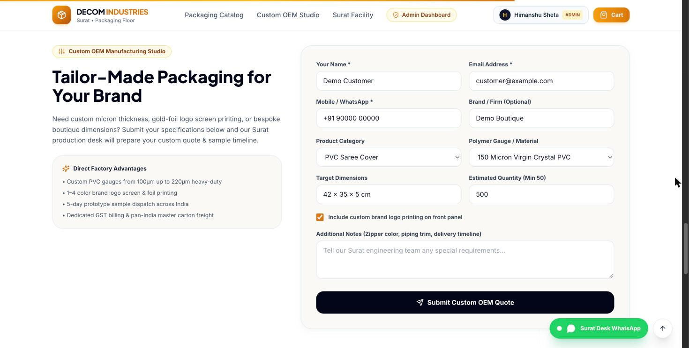

# Decom Industries — Full-Stack E-Commerce & Admin Platform

> 🚧 **Work in progress — not deployed yet.** The app currently runs locally (Docker + PostgreSQL). The screenshots below are from my local build, and all orders, users and revenue numbers in the admin panel are **test data**. A live demo will be linked here once it is deployed.

A full-stack e-commerce storefront and admin platform for **Decom Industries** (Surat, India — apparel packaging & home storage), built step by step with **Next.js + TypeScript + Tailwind CSS**, an **Express + TypeScript + Prisma** REST API, **PostgreSQL** and **Docker** (GitHub Actions CI planned).

## Screenshots

### Storefront
| Home | Product catalog |
| --- | --- |
|  |  |

| Custom OEM quote form |
| --- |
|  |

### Admin dashboard (test data)
| Overview | Products & stock |
| --- | --- |
|  |  |

| Orders & invoices |
| --- |
|  |

## Features

**Storefront**
- Product catalog with categories, search, image galleries and retail or bulk quantities
- Cart and checkout with prices and 18% GST calculated on the server
- Custom OEM quote form for bulk orders with custom sizes, material and logo printing

**Admin dashboard**
- Overview of revenue, orders, products and users, plus an order pipeline (pending → packed → in production → shipped → delivered)
- Product and stock management: add/edit products, adjust stock, archive, export to CSV
- Order management with status updates and invoices
- OEM leads and user/role management

**Backend**
- REST API in Express + TypeScript with Prisma on PostgreSQL and Zod validation
- Orders placed in one database transaction: stock check, server-side prices and tax, stock reduced, order saved
- Authentication with `USER` / `ADMIN` roles; customers only see their own orders

## Architecture

```text
Frontend (Next.js :3000)
   │  HTTP JSON + secure HttpOnly cookies
   ▼
Backend API (Express + TypeScript + Prisma :5000)
   │  SQL via Prisma ORM
   ▼
Database (PostgreSQL :5432 inside Docker)
```

## Project structure

- `frontend/` — storefront (catalog, cart, checkout, account, custom OEM form) and the protected admin dashboard
- `backend/` — REST API, authentication, role-based access (`USER` / `ADMIN`), security middleware, Prisma schema and seed data
- `docker-compose.yml` — runs PostgreSQL, backend and frontend in containers

## Build progress

- [x] **Step 1:** Project structure, `.gitignore`, `.env.example`, Git setup
- [x] **Step 2:** Docker & PostgreSQL setup
- [x] **Step 3:** Backend API foundation & security middleware *(on `feat/backend`, being merged into `main`)*
- [x] **Step 4:** Authentication: password hashing, JWT in HttpOnly cookies, user/admin roles *(on `feat/backend`)*
- [x] **Step 5:** E-commerce & OEM APIs *(on `feat/backend`)*
- [x] **Step 6:** Storefront connected to the API *(on `feat/frontend`)*
- [x] **Step 7:** Protected admin dashboard *(on `feat/frontend`)*
- [ ] **Step 8:** Full Docker setup, pre-commit hooks and GitHub Actions CI
- [ ] **Step 9:** Deployment and live demo link

## Run locally

The full code is on the `feat/frontend` branch until it is merged into `main`.

```bash
git checkout feat/frontend
cp .env.example .env   # set POSTGRES_PASSWORD
docker compose up --build
```

Then open http://localhost:3000.
