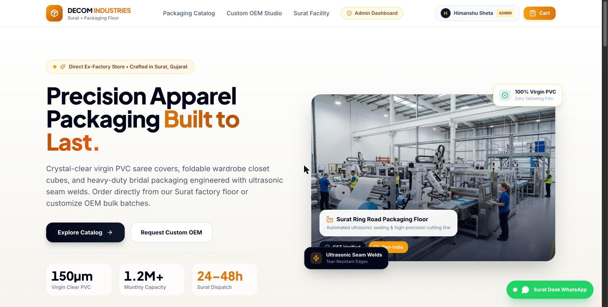
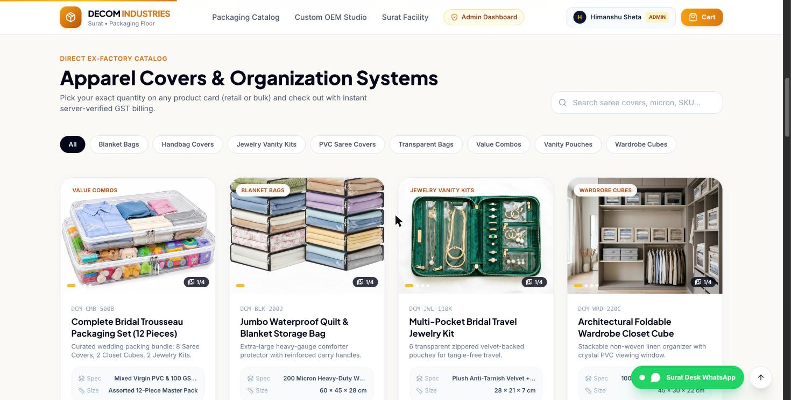
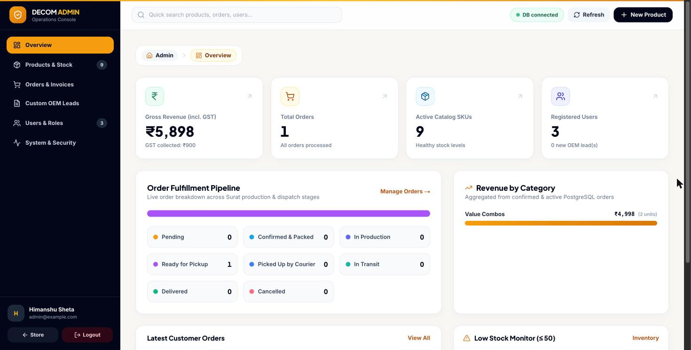
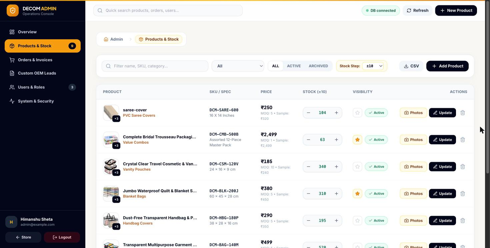
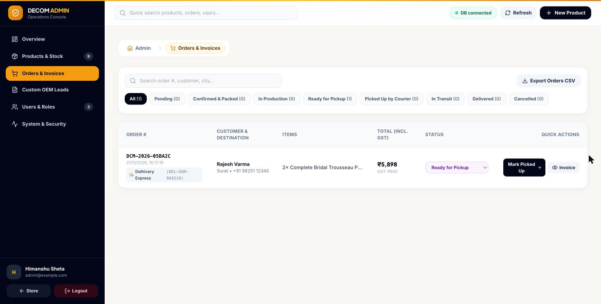

# Decom Industries — Full-Stack E-Commerce & Admin Platform

> 🚧 **Work in progress — not deployed yet.** The app runs locally with Docker and PostgreSQL. The screenshots below are from my local build, and all orders, users and revenue numbers in the admin panel are **test data**. A live demo will be linked here once it is deployed.

A full-stack e-commerce storefront and role-protected admin dashboard for **Decom Industries** (Surat, India — apparel packaging & home storage), built with **Next.js + TypeScript + Tailwind CSS + Framer Motion**, an **Express + TypeScript + Prisma** REST API, **PostgreSQL 16** and **Docker**.

## Screenshots

### Storefront
| Home | Product catalog |
| --- | --- |
|  |  |

| Custom OEM quote form |
| --- |
|  |

### Admin dashboard (test data)
| Overview | Products & stock |
| --- | --- |
|  |  |

| Orders & invoices |
| --- |
|  |

## Features

**Storefront**
- Product catalog with categories, search, image galleries and retail or bulk quantities
- Cart and checkout with prices and 18% GST calculated on the server
- Custom OEM quote form for bulk orders with custom sizes, material and logo printing
- Responsive layout with a mobile drawer and animations

**Admin dashboard**
- Overview of revenue, orders, products and users, plus an order pipeline (pending → packed → in production → courier pickup → delivered)
- Product and stock management: add/edit products and photos, adjust stock, archive, export to CSV
- Order management with status updates, courier tracking and invoices
- OEM leads and user/role management

**Backend & security**
- REST API in Express + TypeScript with Prisma on PostgreSQL and Zod validation
- Checkout in one database transaction: stock check, server-side prices and tax, stock reduced, order saved
- bcrypt password hashing, JWT in HttpOnly cookies with refresh rotation, `USER` / `ADMIN` roles
- Helmet, CORS and rate limiting

## Architecture

```text
Frontend (Next.js + Framer Motion :3000)
   │  HTTP JSON + HttpOnly JWT cookies
   ▼
Backend API (Express + TypeScript + Prisma :4000)
   │  Helmet • CORS • rate limit • Zod • bcrypt • RBAC • transactions
   ▼
Database (PostgreSQL 16 :5439 in Docker + Adminer :8081)
```

## Quick start

```bash
cp .env.example .env   # set POSTGRES_PASSWORD and the JWT secrets
```

### Option A: local development (hot reload)
```bash
# 1. PostgreSQL + Adminer in Docker
docker compose up -d postgres adminer

# 2. Backend API (port 4000)
cd backend && npm install && npx prisma migrate dev && npm run prisma:seed && npm run dev

# 3. Frontend storefront & admin dashboard (port 3000)
cd frontend && npm install && npm run dev
```

### Option B: full Docker stack
```bash
docker compose up --build
```

- Storefront: http://localhost:3000
- Admin dashboard: http://localhost:3000/admin
- Backend health: http://localhost:4000/api/health
- Adminer DB UI: http://localhost:8081

The seed script creates demo accounts with placeholder details (see `backend/prisma/seed.ts`). Change the passwords before using it anywhere other than your own machine.

## Pre-commit hooks
```bash
git config core.hooksPath .githooks
```
Every commit blocks accidental `.env` leaks and runs typecheck + lint on the changed packages.

## Build progress

- [x] **Step 1:** Project structure, `.gitignore`, `.env.example`, Git setup
- [x] **Step 2:** Docker & PostgreSQL 16 + Adminer
- [x] **Step 3:** Backend API foundation, Prisma schema & security middleware
- [x] **Step 4:** Authentication: bcrypt, JWT HttpOnly cookies, refresh rotation, roles
- [x] **Step 5:** E-commerce & OEM APIs (transactional checkout + 18% GST)
- [x] **Step 6:** Storefront connected to the backend API
- [x] **Step 7:** Protected admin dashboard (KPIs, products, orders, OEM quotes, users)
- [x] **Step 8:** Multi-stage Dockerfiles + pre-commit hooks
- [ ] **Step 9:** Activate GitHub Actions CI (workflow ready in `docs/github-actions-ci.yml`)
- [ ] **Step 10:** Deployment and live demo link
